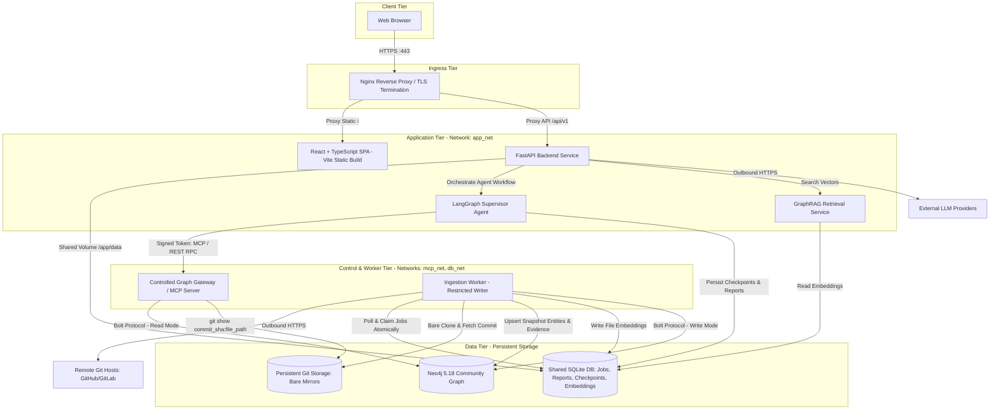
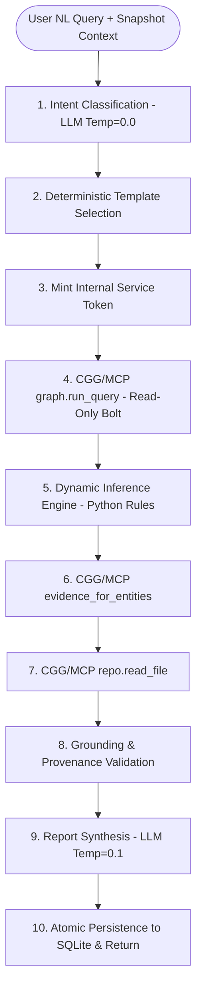
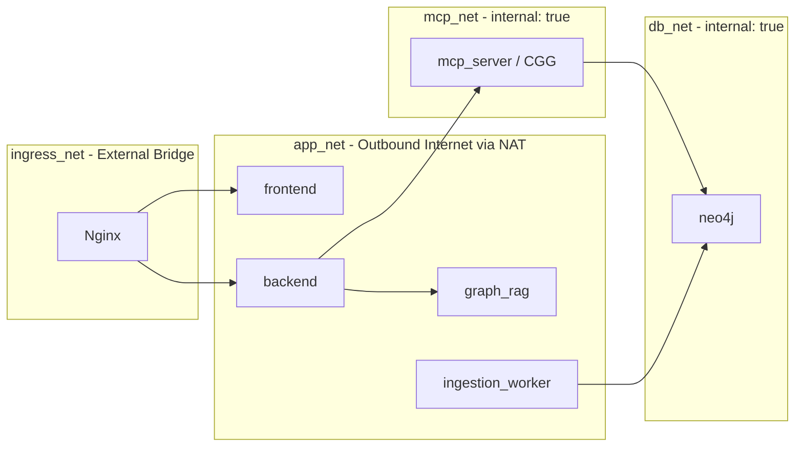

# Autonomous Codebase Knowledge Graph Navigator – Architecture Document (Revision 8)

## 1. Product Vision and System Overview

The **Autonomous Codebase Knowledge Graph Navigator** is an enterprise-grade developer platform that allows software engineers, architects, and security auditors to explore source-code repositories as deterministic knowledge graphs, perform change-impact analysis, and generate evidence-grounded technical reports from natural-language queries.

### 1.1 Core Architectural Principles
- **Snapshot Isolation**: Source code analysis is strictly bound to an immutable repository snapshot defined by the tuple `(repo_id, commit_sha)`. Every entity, relationship, evidence record, embedding, query, and report is strictly scoped to this snapshot. Cross-snapshot graph traversal and non-deterministic branch-floating are architecturally prohibited.
- **Strict Grounding & Provenance**: Every factual claim produced by the system is linked to immutable, verified `Evidence` records citing exact file paths, line ranges, commit SHAs, and syntactic extraction rules.
- **Segregation of Verified vs. Inferred Data**: Syntactically and statically observed relationships extracted from code are stored in Neo4j. Inferred architectural and behavioral couplings are computed dynamically during query execution and are **never** persisted as graph edges.
- **Controlled Read-Only Graph Gateway**: Runtime query execution is strictly read-only and governed by a dedicated **Controlled Graph Gateway (CGG)** implementing the Model Context Protocol (MCP HTTP+SSE) and internal REST RPC. The gateway enforces bounded traversal, query timeouts, row limits, and tenant-level repository isolation. The graph database engine is inaccessible to public clients and application frontends.

### 1.2 System Topology Overview
The MVP comprises eight React + TypeScript dashboard pages backed by:
- **FastAPI Backend**: Handles user authentication, authoritative repository authorization, asynchronous job dispatch, report metadata, and LangGraph workflow orchestration.
- **LangGraph Supervisor Agent**: Coordinates intent classification, deterministic Cypher template selection, dynamic inference evaluation, and grounded markdown synthesis.
- **Controlled Graph Gateway (CGG / MCP Server)**: Internal service providing the exclusive read-only gateway to Neo4j via MCP (HTTP+SSE) and REST RPC, plus commit-pinned source-code retrieval from a persistent bare Git object store.
- **Tree-sitter Ingestion Worker**: Dedicated background worker with restricted write privileges to clone repositories, execute static parsers, upsert snapshot entities and evidence records, and write file embeddings into SQLite.
- **GraphRAG Semantic Retrieval Service**: Provides file-level embedding search against a persistent SQLite vector store.
- **Neo4j 5.18 Community Knowledge Graph**: Graph database engine providing transactional property-graph persistence, uniqueness constraints, and indexed Cypher traversal. Application-layer read-only enforcement in CGG guarantees safe, unprivileged query execution without commercial Enterprise licensing requirements.
- **Persistent Git Storage**: Dedicated volume storing bare Git mirrors to guarantee permanent, commit-pinned source retrieval without retaining raw working tree checkouts.

---

## 2. Complete System Architecture and Data Flow



### 2.1 Service-to-Service Network Access Matrix
| Source Service | Destination Service | Destination Port | Protocol / Transport | Purpose | Outbound Internet? |
|---|---|---|---|---|---|
| `nginx` | `frontend` | 80/TCP | HTTP | Static asset serving | No |
| `nginx` | `backend` | 8000/TCP | HTTP | API request routing | No |
| `backend` | `mcp` (CGG) | 8000/TCP | HTTP / SSE (MCP) | Controlled graph queries & source retrieval | No |
| `backend` | `rag` | 8000/TCP | HTTP RPC | Vector similarity search | No |
| `backend` | External LLMs | 443/TCP | HTTPS | LLM inference (Anthropic / OpenAI) | **Yes** (via `app_net` NAT) |
| `ingestion` | Remote Git | 443/TCP | HTTPS | Repository clone & commit fetching | **Yes** (via `app_net` NAT) |
| `mcp` (CGG) | `neo4j` | 7687/TCP | Bolt | Read-only Cypher query execution | **No** (`db_net` internal) |
| `ingestion` | `neo4j` | 7687/TCP | Bolt | Restricted write operations for snapshot ingestion | **No** (`db_net` internal) |
| `backend`, `ingestion`, `rag` | `shared_sqlite_data` | File System | POSIX / SQLite WAL | Shared application state, jobs, reports, embeddings | No |
| `ingestion`, `mcp` | `shared_git_storage` | File System | POSIX / Git CLI | Bare repository mirrors & commit-pinned source reads | No |

*Note*: Neo4j Bolt port `7687` and CGG port `8000` are strictly bound to internal Docker bridge networks (`db_net`, `mcp_net`) with no public host port mappings.

---

## 3. React + TypeScript Dashboard and Page Structure

The frontend is a single-page application built with **React 18**, **TypeScript 5**, **Material-UI (v6)**, **Vite**, and **TanStack Query (v5)**. All operational views are snapshot-aware, binding operations to the active repository and commit SHA selected in the application context header.

### 3.1 Core Dashboard Pages
| Page | Route | Core Components | Operational Responsibility |
|------|-------|----------------|-----------------------------|
| **1. Dashboard** | `/` | `RepoCardGrid`, `RecentQueriesList`, `SystemHealthIndicator` | Overview of monitored repositories, recent architectural queries, worker queue status, and quick ingestion actions. |
| **2. Repository Explorer** | `/repo/:repoId/snapshot/:commitSha` | `VirtualFileTree`, `EntityDetailDrawer`, `CodeViewerModal` | Virtualized source tree navigation, AST entity inspection per file, and commit metadata display. |
| **3. Interactive Knowledge Graph** | `/graph/:repoId/snapshot/:commitSha` | `CytoscapeGraphCanvas`, `GraphFilterToolbar`, `EvidencePopover` | Interactive 2D/WebGL graph rendering, 1–3 hop neighborhood expansion, edge type filtering, and node evidence popovers. |
| **4. AI Assistant** | `/assistant/:repoId/snapshot/:commitSha` | `ChatTranscript`, `PromptInputBox`, `CollapsibleEvidenceDrawer` | Natural language interface, real-time agent execution status, and verified evidence inspection tabs. |
| **5. Change Impact Analysis** | `/impact/:repoId/snapshot/:commitSha` | `EntitySelector`, `ImpactSubGraphView`, `DynamicInferenceMatrix`, `ExportActionToolbar` | Root cause/target selection, visual split between verified dependencies and dynamic inferred impact, and CSV/JSON export. |
| **6. Technical Report Viewer** | `/report/:repoId/:queryId` | `MarkdownReportRenderer`, `EvidenceReferenceTable`, `DownloadPdfButton` | Formatted technical reports with interactive citation links (`[E-xxxx]`), remediation checklists, and export options. |
| **7. Evaluation & Benchmarking** | `/evaluation` | `BenchmarkRunTrigger`, `LatencyChart`, `MetricScoreTable`, `RunHistoryList` | Execution of automated evaluation suites against standard fixture repos, displaying precision, recall, and grounding metrics. |
| **8. Settings** | `/settings` | `RepoAccessManager`, `TokenExpiryView`, `NotificationPreferences` | Management of connected repositories, view of authenticated user identity and token lifetimes, and UI preferences. *(No arbitrary environment variable editing).* |

### 3.2 Frontend Security & Environment Configuration
- **Vite Environment Handling**: All frontend configuration variables use the `VITE_` prefix (e.g., `VITE_API_BASE_URL=/api/v1`). No private keys, database credentials, or tokens are bundled into client assets.
- **Session Security**: JWT access tokens are held strictly in JavaScript memory. Refresh tokens are stored in secure HTTP-only cookies (`SameSite=Strict; Secure; Path=/api/v1/auth`).

---

## 4. FastAPI Backend and API Contracts

FastAPI provides user authentication, authoritative repository authorization, asynchronous job orchestration, and access to generated reports.

### 4.1 REST API Specification
| Endpoint | Method | Request Model | Response Model | Auth Scope | Description |
|---|---|---|---|---|---|
| `/api/v1/auth/login` | POST | `LoginRequest` | `TokenResponse` | Public | Authenticates credentials; returns RS256 JWT access token and sets HTTP-only refresh cookie. |
| `/api/v1/auth/refresh` | POST | – | `TokenResponse` | Refresh Cookie | Rotates refresh token and returns a new RS256 access token. |
| `/api/v1/auth/logout` | POST | – | `MessageResponse` | `auth:logout` | Revokes current session and clears refresh cookies. |
| `/api/v1/repos` | POST | `RepoCreateRequest` | `RepoResponse` | `repo:write` | Registers a repository, validates Git URL security, and initializes bare mirror. |
| `/api/v1/repos` | GET | – | `List[RepoResponse]` | `repo:read` | Returns all repositories owned by or accessible to the caller. |
| `/api/v1/repos/{repo_id}` | DELETE | – | `JobStatusResponse` | `repo:delete` | Marks repository as `DELETING` and enqueues a privileged Ingestion Worker job to purge Git bare storage, Neo4j entities, reports, and SQLite records. |
| `/api/v1/repos/{repo_id}/snapshots` | GET | – | `List[SnapshotResponse]` | `repo:read` | Lists all successfully ingested immutable snapshots `(repo_id, commit_sha)`. |
| `/api/v1/ingest/start` | POST | `IngestStartRequest` | `JobStatusResponse` | `repo:write` | Enqueues a background ingestion job for `repo_id` at a specified `commit_sha`. |
| `/api/v1/ingest/jobs/{job_id}` | GET | – | `JobStatusResponse` | `repo:read` | Retrieves current status, progress percentage, and logs for an ingestion job. |
| `/api/v1/ingest/jobs/{job_id}/cancel` | POST | – | `JobStatusResponse` | `repo:write` | Requests graceful cancellation of an active or pending ingestion job. |
| `/api/v1/queries/submit` | POST | `QuerySubmitRequest` | `QueryStatusResponse` | `ai:query` | Enqueues an NL query to the LangGraph supervisor for a specific snapshot. |
| `/api/v1/queries/{query_id}` | GET | – | `QueryStatusResponse` | `ai:query` | Polls status of a running query workflow. |
| `/api/v1/queries/{query_id}/reports` | GET | – | `List[ReportSummaryResponse]`| `ai:query` | Lists all historical report versions generated for `query_id`. |
| `/api/v1/reports/{report_id}` | GET | – | `TechnicalReportResponse`| `ai:query` | Returns final synthesized markdown report by its unique `report_id`, metadata, and linked evidence items. |
| `/api/v1/impact` | POST | `ImpactAnalysisRequest` | `ImpactAnalysisResponse`| `graph:read` | Executes change-impact computation for an entity within a snapshot. |
| `/api/v1/eval/run` | POST | `EvalRunRequest` | `EvalRunResponse` | `eval:run` | Enqueues a benchmark evaluation suite run against fixture repositories. |

### 4.2 Authoritative Access Control
FastAPI validates repository ownership by executing an authoritative check against SQLite (`repo_memberships` table) for every request referencing `repo_id`. Client-supplied tokens carrying static claims are verified against the authoritative database record to prevent unauthorized access via stale tokens.

---

## 5. LangGraph Supervisor and Agent Workflow

The LangGraph Supervisor orchestrates query analysis, deterministic template execution, dynamic inference, and report synthesis.



### 5.1 Pipeline Deadlines and Safe Cancellation Propagation
- **Overall Workflow Deadline**: 30,000 ms. If total execution exceeds this threshold, the workflow aborts, an explicit cancellation call is sent to CGG, and the job status transitions to `TIMED_OUT`.
- **CGG/MCP RPC Deadline**: 6,000 ms. Allows clean cancellation before client timeouts.
- **Neo4j Transaction Timeout**: 5,000 ms (`tx_timeout=5.0` on the transaction configuration).
- **Safe Server-Side Cancellation Mechanics**: Neo4j Python driver `Transaction` and `Session` objects are not thread-safe and must not be manipulated concurrently across threads. When a client cancels or disconnects:
  1. The FastAPI backend sends `POST /api/v1/tools/cancel/{query_id}` to CGG.
  2. CGG signals the thread-safe cancellation event registered for `query_id` (`_cancellation_events[query_id].set()`).
  3. The worker thread owning the transaction checks this event during streaming iteration, stops reading, and performs `tx.rollback()` and `session.close()` exclusively on its owning thread.
  4. For queries blocked engine-side before records stream, the driver's native transaction timeout (`timeout=5.0`) ensures the database engine aborts server processing after 5 seconds, or a separate independent management session issues `TERMINATE TRANSACTION $tx_id`.

### 5.2 Idempotency, Report Identity, and Crash Recovery
- **Workflow ID**: Deterministic format `wf_<query_id>` (where `query_id` is a UUIDv4 string).
- **Report Identity**:
  - **Primary Key**: `report_id` (always a standard UUIDv4 string, e.g., `3fa85f64-5717-4562-b3fc-2c963f66afa6`).
  - **Indexed Foreign Key**: `query_id` (UUIDv4 string referencing the originating user prompt).
  - **Single-Workflow Retry vs. Intentional Re-Generation**:
    - **Automated Workflow Retries**: When LangGraph initializes an execution run, it mints a unique `report_id = str(uuid.uuid4())` and stores it in the workflow state (`state["report_id"]`). If a transient failure occurs and the workflow retries, the worker restores `state["report_id"]` from SQLite `SqliteSaver`. It executes an idempotent upsert:
      ```sql
      INSERT INTO reports (report_id, query_id, repo_id, commit_sha, query_text, markdown_body, created_at)
      VALUES (:report_id, :query_id, :repo_id, :commit_sha, :query_text, :markdown_body, CURRENT_TIMESTAMP)
      ON CONFLICT(report_id) DO UPDATE SET
          markdown_body = excluded.markdown_body,
          created_at = CURRENT_TIMESTAMP;
      ```
      This guarantees automated retries update the in-flight report record without creating duplicate rows or altering the `report_id`.
    - **Intentional User Re-Runs**: When a user re-submits or forks an existing query to generate an updated report, a fresh workflow execution is instantiated with a newly generated `report_id = str(uuid.uuid4())`. This creates a new distinct report record referencing the same `query_id`, preserving full historical versioning.
- **Idempotency Keys**: Side-effecting operations utilize step keys `idemp_<query_id>_<step_name>`.
- **Atomic Checkpointing**: State transitions are committed to SQLite via `SqliteSaver` after each completed graph node.
- **Recovery Guarantee**: The platform guarantees **at-least-once execution with idempotent deduplication**. If a crash occurs:
  1. Upon restart, the supervisor inspects `SqliteSaver` checkpoints.
  2. The workflow resumes from the last successfully committed node.
  3. Workflows exceeding 2 failed recovery retries transition to `FAILED` with diagnostic logs.

---

## 6. Controlled Graph Gateway (CGG) & MCP Tool Contracts

### 6.1 Architectural Decision: Model Context Protocol (MCP) + REST RPC
To ensure enterprise standards compliance while supporting high-throughput internal orchestration, the graph gateway is implemented as the **Controlled Graph Gateway (CGG)** offering dual transport interfaces:
1. **MCP Protocol Transport (HTTP + SSE)**: Conforms to the Anthropic Model Context Protocol specification (2024). Exposes `GET /mcp/sse` (SSE connection for server events) and `POST /mcp/message` (JSON-RPC 2.0 messages). Exposes tools: `graph.run_query`, `graph.get_evidence`, `graph.get_evidence_for_entities`, and `repo.read_file`.
2. **Internal REST RPC Transport**: Exposes direct endpoints (`POST /api/v1/tools/run_query`, `GET /api/v1/tools/evidence/{id}`, `POST /api/v1/tools/evidence/batch`, `GET /api/v1/tools/file`) sharing the identical validation, authorization, streaming limit, and snapshot isolation logic.

### 6.2 Service-to-Service Authentication & Scope Binding
All incoming requests to CGG must present a signed internal service token in the `X-Internal-Service-Auth` header:
- **Algorithm**: Asymmetric **RS256** using an internal service private key (`internal_service_key.pem`).
- **Claims**:
  ```json
  {
    "sub": "backend_service",
    "authorized_repo_id": "9b1deb4d-3b7d-4bad-9bdd-2b0d7b3dcb6d",
    "authorized_commit_sha": "d670460b4b4aece5915caf5c68d12f560a9fe3e4",
    "aud": "cgg_mcp_service",
    "exp": 1773062400
  }
  ```
- **Scope Enforcement**: CGG derives the authorized `repo_id` and `commit_sha` exclusively from the verified token claims. If payload parameters specify a different `repo_id` or `commit_sha`, CGG rejects the request with HTTP 403 `SCOPE_MISMATCH`.

### 6.3 Driver Lifecycle, Memory Accounting, and Safe Cooperative Cancellation
- **Driver**: `neo4j>=5.18.0,<6.0.0` Python official driver (synchronous API).
- **Session & Transaction Lifecycle with Thread-Safe Cancellation & Memory Accounting**:
  ```python
  import json
  import threading
  import neo4j

  # Thread-safe registry of cooperative cancellation flags (avoids cross-thread driver manipulation)
  _cancellation_events: dict[str, threading.Event] = {}

  def execute_cgg_query(query_id: str, query_string: str, parameters: dict) -> list[dict]:
      cancel_event = threading.Event()
      _cancellation_events[query_id] = cancel_event
      current_buffer_bytes = 0
      records = []

      with driver.session(database="neo4j", default_access_mode=neo4j.AccessMode.READ) as session:
          # Native server-side transaction timeout guarantees engine abort if blocked
          tx = session.begin_transaction(timeout=5.0)
          try:
              result = tx.run(query_string, parameters)
              for record in result:
                  # 1. Cooperative cancellation check (handled safely by the owning thread)
                  if cancel_event.is_set():
                      tx.rollback()
                      raise QueryCancelledException(f"Query {query_id} was cancelled by client")

                  # 2. Hard 500-row limit check
                  if len(records) >= 500:
                      tx.rollback()
                      raise ResultLimitExceededException("Query exceeded 500 records")

                  # 3. Accurate memory accounting
                  record_data = record.data()
                  chunk_size = len(json.dumps(record_data).encode("utf-8"))
                  current_buffer_bytes += chunk_size
                  if current_buffer_bytes > 64 * 1024 * 1024:
                      tx.rollback()
                      raise MemoryLimitExceededException("Result payload exceeded 64 MiB")

                  records.append(record_data)

              tx.commit()
              return records
          except Exception:
              tx.rollback()
              raise
          finally:
              # Safe cleanup strictly within the owning thread
              _cancellation_events.pop(query_id, None)
              del records
              current_buffer_bytes = 0
  ```
- **Cancellation Endpoint**: CGG exposes `POST /api/v1/tools/cancel/{query_id}`. When invoked, CGG retrieves `_cancellation_events.get(query_id)` and calls `event.set()`. The owning worker thread checks this flag on the next record yield, issues `tx.rollback()`, and terminates cleanly without concurrent driver race conditions.
- If the 501st record is encountered, `tx.rollback()` is invoked immediately by the owning thread, terminating server-side query state without consuming further database resources, returning HTTP 400 `RESULT_LIMIT_EXCEEDED`.

### 6.4 Tool Contracts

#### 1. `graph.run_query`
- **MCP Tool Name**: `graph.run_query`
- **Arguments**:
  - `operation` (string, required): Approved template ID (e.g., `"impact_downstream_2hop"`).
  - `parameters` (object, required): Named parameter bindings (e.g., `{"start_entity_id": "..."}`).
- **Behavior**: Injects verified `$repo_id` and `$commit_sha`. Enforces 500-row limit and 5.0 s timeout.

#### 2. `graph.get_evidence`
- **MCP Tool Name**: `graph.get_evidence`
- **Arguments**:
  - `evidence_id` (string, required): Format `E-<uuid>`.
- **Behavior**: Fetches evidence node; verifies that node's `repo_id` and `commit_sha` match caller's token.

#### 3. `graph.get_evidence_for_entities`
- **MCP Tool Name**: `graph.get_evidence_for_entities`
- **Arguments**:
  - `entity_ids` (array of strings, required): List of snapshot entity IDs (max 50).
- **Behavior**: Retrieves connected `EntityEvidence` and `RelationshipEvidence` nodes for the specified entities within the active snapshot.

#### 4. `repo.read_file`
- **MCP Tool Name**: `repo.read_file`
- **Arguments**:
  - `file_path` (string, required): Canonical relative file path.
  - `start_line` (integer, required): 1-indexed start line.
  - `end_line` (integer, required): 1-indexed end line.
- **Behavior**: Executes `git show <commit_sha>:<file_path>` from `/app/git_storage/<repo_id>.git`. Slices line range. Validates file path against commit tree.

---

## 7. Neo4j Graph Schema and Repository Snapshot Isolation

### 7.1 Separation of Logical vs. Snapshot-Specific Entity IDs
To support cross-commit architectural diffing while maintaining strict snapshot isolation in the graph:
1. **Logical Entity ID (`logical_entity_id`)**: Stable representation of an entity across commits:
   ```
   <repo_id>::<entity_type>::<encoded_qualified_name>[::<signature_hash>]
   ```
2. **Snapshot-Specific Entity ID (`entity_id`)**: Globally unique primary key in Neo4j, bound to the immutable commit:
   ```
   <repo_id>::<commit_sha>::<entity_type>::<encoded_qualified_name>[::<signature_hash>]
   ```

#### Canonical Delimiter Encoding Specification
To prevent delimiter collisions when file paths or qualified names contain colons (`::`), slashes (`/`), or spaces, all entity sub-components (`encoded_qualified_name`, `canonical_file_path`) are normalized using **RFC 3986 percent-encoding** (`:` becomes `%3A`, `/` becomes `%2F`, ` ` becomes `%20`). The double-colon `::` is strictly reserved as the structural field delimiter.

| Entity Type | Identifier Template (`entity_id`) | Notes |
|---|---|---|
| **File** | `<repo_id>::<commit_sha>::File::<encoded_file_path>` | `encoded_file_path` is relative to repo root (e.g., `src%2Fauth.py`). |
| **Module** | `<repo_id>::<commit_sha>::Module::<encoded_module_name>` | e.g., `my_app.services.auth`. |
| **Class** | `<repo_id>::<commit_sha>::Class::<encoded_class_name>` | Fully qualified with module and enclosing class scope. |
| **Function** | `<repo_id>::<commit_sha>::Function::<encoded_name>::<signature_hash>` | `signature_hash`: First 12 hex characters of SHA-256 of normalized parameter types and return type. Distinguishes overloaded signatures without hashing function body. |
| **Variable** | `<repo_id>::<commit_sha>::Variable::<encoded_scope>::<var_name>` | Scope includes module/class/function namespace. |

### 7.2 Node Labels and Mandatory Properties
Every code entity node carries the common abstract label `Entity` in addition to its concrete label:
```cypher
(:Repo)
(:Snapshot)
(:Entity:File)
(:Entity:Module)
(:Entity:Class)
(:Entity:Function)
(:Entity:Variable)
(:Evidence:EntityEvidence)
(:Evidence:RelationshipEvidence)
(:UnresolvedCall)
```

#### Mandatory Properties
- **`Repo`**: `repo_id` (PK, UUID), `url`, `default_branch`, `created_at`.
- **`Snapshot`**: `snapshot_id` (PK, format `<repo_id>::<commit_sha>`), `repo_id`, `commit_sha`, `ingested_at`.
- **`Entity` (Common across all entity nodes)**:
  - `entity_id` (PK, string)
  - `logical_entity_id` (string, indexed)
  - `repo_id` (string, indexed)
  - `commit_sha` (string, indexed)
  - `file_path` (string, indexed)
  - `name` (string)
  - `content_hash` (string, 16-char SHA-256 of entity source body)
- **`Evidence` (Common properties)**:
  - `evidence_id` (PK, string format `E-f47ac10b-58cc-4372-a567-0e02b2c3d479`)
  - `repo_id` (string)
  - `commit_sha` (string)
  - `evidence_type` (`"ENTITY"` or `"RELATIONSHIP"`)
  - `file_path` (string)
  - `line_range` (string format `"start-end"`)
  - `extraction_rule` (string)
  - `description` (string)
- **`EntityEvidence` specific property**:
  - `entity_id` (string, references declared snapshot entity)
- **`RelationshipEvidence` specific properties**:
  - `source_entity_id` (string)
  - `target_entity_id` (string)
  - `relationship_type` (string: `"CALLS"` | `"IMPORTS"` | `"EXTENDS"` | `"DECLARES"`)
- **`UnresolvedCall` properties**:
  - `call_id` (PK, string format `<repo_id>::<commit_sha>::UnresolvedCall::<uuid>`)
  - `repo_id` (string, indexed)
  - `commit_sha` (string, indexed)
  - `source_entity_id` (string, indexed)
  - `invoked_symbol_name` (string)
  - `file_path` (string)
  - `line_range` (string format `"start-end"`)

### 7.3 Uniqueness Constraints (Neo4j 5.18 Syntax)
```cypher
// 1. Repository constraint
CREATE CONSTRAINT repo_pk IF NOT EXISTS
FOR (r:Repo) REQUIRE r.repo_id IS UNIQUE;

// 2. Snapshot constraint
CREATE CONSTRAINT snapshot_pk IF NOT EXISTS
FOR (s:Snapshot) REQUIRE s.snapshot_id IS UNIQUE;

// 3. Global Entity constraint across all code entities
CREATE CONSTRAINT entity_pk IF NOT EXISTS
FOR (e:Entity) REQUIRE e.entity_id IS UNIQUE;

// 4. Global Evidence constraint
CREATE CONSTRAINT evidence_pk IF NOT EXISTS
FOR (ev:Evidence) REQUIRE ev.evidence_id IS UNIQUE;

// 5. Unresolved Call constraint
CREATE CONSTRAINT unresolved_call_pk IF NOT EXISTS
FOR (uc:UnresolvedCall) REQUIRE uc.call_id IS UNIQUE;

// 6. Performance composite lookup index on snapshot scoping
CREATE INDEX entity_snapshot_idx IF NOT EXISTS
FOR (e:Entity) ON (e.repo_id, e.commit_sha);
```

### 7.4 Relationship Model & Traversal Isolation
Every relationship stores `repo_id` and `commit_sha`. Cross-snapshot traversals are structurally prevented by filtering on both properties across all nodes and edges:
- `(:Entity)-[:IMPORTS {repo_id, commit_sha}]->(:Entity)`
- `(:Entity)-[:CALLS {repo_id, commit_sha}]->(:Entity)`
- `(:Entity)-[:EXTENDS {repo_id, commit_sha}]->(:Entity)`
- `(:Entity)-[:DECLARES {repo_id, commit_sha}]->(:Entity)`
- `(:Entity)-[:HAS_UNRESOLVED_CALL {repo_id, commit_sha}]->(:UnresolvedCall)`

**Relationship Ingestion Precondition**: The Ingestion Worker verifies that `source.commit_sha == $commit_sha` AND `target.commit_sha == $commit_sha` AND `source.repo_id == $repo_id` AND `target.repo_id == $repo_id` before creating any relationship. If a target entity cannot be resolved in the same snapshot, no graph edge is created; it is logged as an unresolved call.

**Inferred Relationships**: `AFFECTS` relationships are **NEVER written to or stored in Neo4j**. Inferred impacts are calculated on-the-fly during impact analysis.

---

## 8. Tree-sitter Ingestion & Persistent Git Storage

### 8.1 Bare Git Mirror Architecture & Privileged Deletion
To allow persistent, commit-pinned source retrieval without retaining raw working tree checkouts, the ingestion service maintains a bare Git repository per project inside a shared persistent volume:
```
/app/git_storage/<repo_id>.git
```

#### Privileged Repository Deletion Lifecycle
The Controlled Graph Gateway (CGG) is strictly read-only and possesses no deletion privileges. When a repository deletion is initiated via `DELETE /api/v1/repos/{repo_id}`:
1. **Status Transition**: FastAPI transitions the repository record in SQLite to `status = 'DELETING'`. Immediate API queries, new ingestions, and background agent tasks for `repo_id` are rejected with HTTP 409 `REPOSITORY_LOCKED`.
2. **Privileged Cleanup Job Dispatch**: FastAPI enqueues a privileged deletion task in the SQLite `jobs` table (`job_type = 'REPO_PURGE'`).
3. **Worker Execution**: The **Ingestion Worker** (possessing Neo4j write credentials and shared volume write access) claims the purge task:
   - **Graph Purge**: Executes batched node deletions in Neo4j:
     `MATCH (n {repo_id: $repo_id}) DETACH DELETE n;`
   - **Storage Purge**: Deletes the bare Git mirror directory via `rm -rf /app/git_storage/<repo_id>.git`.
   - **Database Purge**: Removes all associated embeddings, reports, job logs, and memberships from SQLite within an atomic `BEGIN IMMEDIATE` transaction.
   - **Finalization**: Deletes the `Repo` row in SQLite and marks the job `COMPLETED`.

### 8.2 Ingestion Security Hardening
- **UUID Validation**: `repo_id` must strictly match regex `^[0-9a-f]{8}-[0-9a-f]{4}-4[0-9a-f]{3}-[89ab][0-9a-f]{3}-[0-9a-f]{12}$`. Any input with path traversal characters (`/`, `\`, `..`) is rejected before constructing filesystem paths.
- **Enforced Egress & Anti-DNS-Rebinding Protection**:
  - Pre-clone DNS resolution alone is susceptible to Time-of-Check to Time-of-Use (TOCTOU) DNS rebinding. To eliminate this vector:
    1. Git clone commands execute with `-c http.followRedirects=false`.
    2. Outbound Git connections are routed through an internal egress validation hook / proxy that verifies the actual target IP address during socket connect time.
    3. Any connection attempting to establish a TCP handshake with private, loopback, or reserved IP ranges is terminated before payload dispatch:
       - Blocked IPv4: `0.0.0.0/8`, `10.0.0.0/8`, `127.0.0.0/8`, `169.254.0.0/16`, `172.16.0.0/12`, `192.168.0.0/16`.
       - Blocked IPv6: `::1`, `fc00::/7`, `fe80::/10`.
    4. If redirects are explicitly negotiated, the redirect `Location` URI is re-parsed and its resolved IP is re-validated through the same filter before opening the new socket.
- **Subprocess Environment**: Git commands execute with restricted environment `env={"PATH": "/usr/bin:/bin", "GIT_TERMINAL_PROMPT": "0"}` and execution timeout of 120 s.
- **Git Hook & Filter Neutralization**: Clones execute with `-c core.hooksPath=/dev/null -c protocol.file.allow=never -c protocol.ext.allow=never -c filter.lfs.smudge= -c filter.lfs.clean=`.
- **Safe Scratch Extraction**: Extracted using Python `tarfile.extractall` with `filter='data'` (Python 3.12+) ensuring all extracted files resolve strictly within `/tmp/scratch/<job_id>`. Symlinks pointing outside the scratch directory are rejected.
- **Resource Limits**: Max repo pack size: 500 MiB; max extracted size: 1 GiB; max file count: 25,000; max individual file size: 2 MiB.

### 8.3 Ingestion Workflow Stages
1. **Repository Synchronization**:
   - If `/app/git_storage/<repo_id>.git` does not exist: clones bare mirror.
   - If exists: executes `git --git-dir=/app/git_storage/<repo_id>.git fetch origin`.
2. **Commit Verification**:
   - Verifies target commit: `git --git-dir=/app/git_storage/<repo_id>.git cat-file -e <commit_sha>^{commit}`. If missing, executes `fetch origin <commit_sha>` or aborts with `COMMIT_NOT_FOUND`.
3. **Tree Extraction**:
   - Extracts commit tree to `/tmp/scratch/<job_id>`.
4. **Static Parsing & Extraction Semantics**:
   - Tree-sitter parses supported languages (Python, TypeScript, JavaScript, Go, Java).
   - Categorizes findings:
     - **Syntactically Observed**: Concrete AST constructs (function definitions, imports).
     - **Statically Resolved**: Fully resolved symbols within the file or deterministically imported modules in the same snapshot.
     - **Unresolved Calls**: Dynamic invocations (e.g., `getattr()`, polymorphic calls, dynamic dispatches) where static analysis cannot deterministically identify the target entity. Emitted as discrete `(:UnresolvedCall)` nodes storing `source_entity_id`, `invoked_symbol_name`, `file_path`, and `line_range`, connected to the caller via `[:HAS_UNRESOLVED_CALL]`.
5. **Batch Transactional Upsert**:
   - Upserts `Entity` nodes, verified relationships, `EntityEvidence`, `RelationshipEvidence`, and `UnresolvedCall` nodes using Neo4j writer credentials.
6. **Workspace Cleanup**:
   - Ephemeral scratch directory `/tmp/scratch/<job_id>` is wiped in a `finally` block via `shutil.rmtree`. The bare Git mirror in `/app/git_storage/<repo_id>.git` is retained for runtime source-code reads.

---

## 9. GraphRAG Retrieval and Embedding Storage

### 9.1 Storage Schema (SQLite)
File-level embeddings are stored in the shared SQLite database:
```sql
CREATE TABLE IF NOT EXISTS embeddings (
    repo_id TEXT NOT NULL,
    commit_sha TEXT NOT NULL,
    file_path TEXT NOT NULL,
    vector BLOB NOT NULL,
    model_version TEXT NOT NULL,
    preprocess_version TEXT NOT NULL,
    content_hash TEXT NOT NULL,
    created_at TIMESTAMP DEFAULT CURRENT_TIMESTAMP,
    PRIMARY KEY (repo_id, commit_sha, file_path)
);

CREATE INDEX IF NOT EXISTS idx_embeddings_lookup
ON embeddings(repo_id, commit_sha);
```

### 9.2 Embedding Model & Cache Invalidation
- **Model**: `sentence-transformers/all-mpnet-base-v2` (version pinned: commit `9a32259`).
- **Chunking/Preprocessing**: `preprocess_version: v1_file_head512` (extracts docstrings, class signatures, and head 512 tokens).
- **Cache Reuse Across Commits**: An existing embedding from commit $C_1$ is reused for commit $C_2$ if and only if:
  `content_hash == existing.content_hash AND model_version == existing.model_version AND preprocess_version == existing.preprocess_version`.
- **Vector Search Execution**: Linear scan over vectors matching `(repo_id, commit_sha)`. Cosine similarity is computed via NumPy. Equal similarity scores are broken deterministically by sorting alphabetically on `file_path`.

---

## 10. Cypher Generation, Validation, and Read-Only Execution

### 10.1 Reviewed, Parameterized Query Templates
Raw LLM-generated Cypher is never executed against the knowledge graph. Queries are dispatched exclusively via pre-approved template identifiers with **full path node and edge snapshot validation**:

```cypher
// Template: impact_downstream_2hop
MATCH (start:Entity {entity_id: $start_entity_id, repo_id: $repo_id, commit_sha: $commit_sha})
MATCH path = (start)<-[:CALLS|IMPORTS|EXTENDS*1..2]-(affected:Entity)
WHERE all(n IN nodes(path) WHERE n.repo_id = $repo_id AND n.commit_sha = $commit_sha)
  AND all(r IN relationships(path) WHERE r.repo_id = $repo_id AND r.commit_sha = $commit_sha)
RETURN
    affected.entity_id AS entity_id,
    affected.file_path AS file_path,
    affected.name AS name,
    labels(affected) AS labels,
    length(path) AS hop_distance,
    [r IN relationships(path) | type(r)] AS relationship_types
LIMIT 501;
```

```cypher
// Template: evidence_for_entities
MATCH (e:Entity {repo_id: $repo_id, commit_sha: $commit_sha})
WHERE e.entity_id IN $entity_ids
OPTIONAL MATCH (ev_ent:EntityEvidence {repo_id: $repo_id, commit_sha: $commit_sha})-[:EVIDENCE_FOR]->(e)
OPTIONAL MATCH (ev_rel:RelationshipEvidence {repo_id: $repo_id, commit_sha: $commit_sha})
WHERE (ev_rel)-[:SOURCE_OF]->(e) OR (ev_rel)-[:TARGET_OF]->(e)
RETURN
    e.entity_id AS entity_id,
    collect(DISTINCT ev_ent.evidence_id) AS entity_evidence_ids,
    collect(DISTINCT ev_rel.evidence_id) AS relationship_evidence_ids;
```

*Note*: Mismatches between requested depth and traversal length are resolved by offering discrete templates: `impact_downstream_1hop`, `impact_downstream_2hop`, and `impact_downstream_3hop`.

### 10.2 Defense-in-Depth Validation Layers
1. **Template Mapping**: Operation identifier must match an internal pre-compiled template.
2. **AST Validation**: Cypher query AST is inspected before dispatch. Any write clause (`CREATE`, `MERGE`, `SET`, `DELETE`, `DROP`, `ALTER`) or non-whitelisted procedure call triggers immediate rejection.
3. **Driver Session Read Mode**: Driver session is configured strictly with `default_access_mode=neo4j.AccessMode.READ`, causing the driver to reject any mutation statements at the transaction boundary. (Optional commercial Enterprise deployments can additionally enforce database-level `readonly_role`).

---

## 11. Evidence Provenance and Grounding Validation

Evidence records provide immutable provenance for all code entities and relationships.

### 11.1 Evidence Data Models
```json
// Entity Evidence (Declaration Provenance)
{
  "evidence_id": "E-f47ac10b-58cc-4372-a567-0e02b2c3d479",
  "repo_id": "9b1deb4d-3b7d-4bad-9bdd-2b0d7b3dcb6d",
  "commit_sha": "d670460b4b4aece5915caf5c68d12f560a9fe3e4",
  "evidence_type": "ENTITY",
  "entity_id": "9b1deb4d...::d670460b...::Function::auth.login::e4d909c290d0",
  "file_path": "src/auth.py",
  "line_range": "45-52",
  "extraction_rule": "tree_sitter_function_declaration",
  "description": "Syntactic declaration of function login()"
}

// Relationship Evidence (Coupling Provenance)
{
  "evidence_id": "E-7c9e6679-7425-40de-944b-e07fc1f90ae7",
  "repo_id": "9b1deb4d-3b7d-4bad-9bdd-2b0d7b3dcb6d",
  "commit_sha": "d670460b4b4aece5915caf5c68d12f560a9fe3e4",
  "evidence_type": "RELATIONSHIP",
  "source_entity_id": "9b1deb4d...::d670460b...::Function::api.handle_auth::112233445566",
  "target_entity_id": "9b1deb4d...::d670460b...::Function::auth.login::e4d909c290d0",
  "relationship_type": "CALLS",
  "file_path": "src/api.py",
  "line_range": "112-114",
  "extraction_rule": "tree_sitter_call_expression",
  "description": "Static call from handle_auth() to login()"
}
```

### 11.2 Graph Topology of Evidence Nodes
- `(:Evidence:EntityEvidence)-[:EVIDENCE_FOR {repo_id, commit_sha}]->(:Entity)`: Cardinality 1:1 for Entity evidence.
- `(:Evidence:RelationshipEvidence)-[:SOURCE_OF {repo_id, commit_sha}]->(:Entity)` and `(:Evidence:RelationshipEvidence)-[:TARGET_OF {repo_id, commit_sha}]->(:Entity)`: Cardinality 1:1 for each endpoint.
- **Bi-Directional Traversal Guarantee**: Every verified relationship edge (e.g., `(caller)-[:CALLS]->(callee)`) has exactly one corresponding `RelationshipEvidence` node connected via `(ev)-[:SOURCE_OF]->(caller)` and `(ev)-[:TARGET_OF]->(callee)`. Querying evidence for either the source or target endpoint deterministically returns the identical `RelationshipEvidence` record, ensuring complete provenance regardless of traversal direction.

### 11.3 Deep Grounding Validation
When validating reports, the validator does not merely check for string presence of `[E-xxxx]`. It verifies:
1. `evidence_id` exists in the database.
2. `repo_id` and `commit_sha` match the current report's snapshot context.
3. The cited file path and line numbers correspond to the entity or relationship asserted in the text.
4. Any assertion lacking valid grounding is purged or flagged as `[UNVERIFIED FINDING]`.

---

## 12. Change-Impact Analysis

Change-Impact Analysis evaluates the ripple effects of modifying an entity within a snapshot.

### 12.1 Categorization of Impact & Formal Inference Rules
- **Verified Downstream Dependencies**: Directly retrieved from Neo4j following verified incoming relationships (`<-[:CALLS|IMPORTS|EXTENDS]-`). These represent deterministic syntactic couplings verified by static analysis.
- **Inferred Potential Impact**: Dynamically computed in application code using three formal, bounded inference rules:
  1. `shared_module_context`:
     - **Graph Input**: Target entity $E$ with property `file_path`.
     - **Query Pattern**: `MATCH (sibling:Entity {repo_id: $r, commit_sha: $c, file_path: $fp}) WHERE sibling.entity_id <> $E.entity_id RETURN sibling`.
     - **Output**: Sibling entities co-located in the identical source file/module.
     - **Confidence Weight**: 0.4. Rationale: File-level co-location implies shared local state or configuration.
  2. `polymorphic_inheritance`:
     - **Graph Input**: Target class entity $C$ participating in inheritance.
     - **Query Pattern**: `MATCH (C:Entity:Class {repo_id: $r, commit_sha: $c})-[:EXTENDS]->(base:Entity:Class)<-[:EXTENDS]-(peer:Entity:Class) WHERE C.entity_id <> peer.entity_id RETURN peer, base`.
     - **Output**: Peer classes sharing a common base class or interface abstraction.
     - **Confidence Weight**: 0.6. Rationale: Modifying an overridden method may break peer implementations.
  3. `unresolved_dynamic_call`:
     - **Graph Input**: Target entity $E$ possessing unresolvable dynamic call sites recorded during Tree-sitter ingestion.
     - **Query Pattern**:
       ```cypher
       MATCH (E:Entity {entity_id: $start_entity_id, repo_id: $repo_id, commit_sha: $commit_sha})
       MATCH (E)-[:HAS_UNRESOLVED_CALL {repo_id: $repo_id, commit_sha: $commit_sha}]->(uc:UnresolvedCall {repo_id: $repo_id, commit_sha: $commit_sha})
       MATCH (cand:Entity:Function {repo_id: $repo_id, commit_sha: $commit_sha, name: uc.invoked_symbol_name})
       RETURN
           uc.call_id AS call_id,
           uc.invoked_symbol_name AS invoked_symbol,
           uc.file_path AS call_file,
           uc.line_range AS call_lines,
           cand.entity_id AS candidate_entity_id,
           cand.file_path AS candidate_file;
       ```
     - **Output**: Candidate functions matching the invoked identifier.
     - **Confidence Weight**: 0.3.
     - **Strict Classification**: Inferred findings from dynamic calls are **strictly classified as potential/uncertain**, and are never presented or aggregated as verified dependencies.
  *Note*: Inferred impacts are **never** stored as relationships in Neo4j.

### 12.2 Explainable Impact Relevance Scoring

$$\text{Impact Relevance} = 0.5 \cdot \text{File Similarity} + 0.5 \cdot \left(\frac{1}{\text{Hop Distance} + 1}\right)$$

Where:
- $\text{File Similarity} \in [0.0, 1.0]$: Cosine similarity between query embedding and the embedding of the file containing the impacted entity.
- If query text or file embedding is missing, $\text{File Similarity}$ defaults to $0.0$, scaling purely by inverse topological distance:

$$\text{Impact Relevance}_{\text{fallback}} = \frac{1}{\text{Hop Distance} + 1}$$

### 12.3 Engineering Risk Rating Precedence
Reported separately as an explainable ordinal category:
- **`CRITICAL`**: Impacted component is a public API route, database schema migration, or downstream dependent count $\ge 10$.
- **`HIGH`**: Downstream dependent count $\ge 5$ or hop distance $= 1$.
- **`MEDIUM`**: Downstream dependent count is between $2$ and $4$ or hop distance $= 2$.
- **`LOW`**: Downstream dependent count $\le 1$ and hop distance $\ge 3$.

---

## 13. Evidence-Backed Technical Reports

Technical reports represent the comprehensive synthesis of an architectural query.

### 13.1 Report Structure
1. **Executive Summary**: Overview of query intent, target components, and risk summary.
2. **Verified Findings Table**: Entities, file paths, line numbers, relationship types, and explicit evidence links `[E-xxxx]`.
3. **Inferred Architectural Impact**: Dynamic inference findings, rationale, and supporting evidence.
4. **Remediation & Refactoring Strategy**: Concrete, ordered remediation steps.
5. **Evidence Provenance Appendix**: Complete audit table resolving every citation `[E-xxxx]` to file path, line numbers, commit SHA, and rule.

### 13.2 Immutability, Schema & Persistence
Reports are persisted in SQLite with explicit primary and foreign key separation:
```sql
CREATE TABLE IF NOT EXISTS reports (
    report_id TEXT PRIMARY KEY,
    query_id TEXT NOT NULL,
    repo_id TEXT NOT NULL,
    commit_sha TEXT NOT NULL,
    query_text TEXT NOT NULL,
    markdown_body TEXT NOT NULL,
    created_at TIMESTAMP DEFAULT CURRENT_TIMESTAMP
);

CREATE INDEX IF NOT EXISTS idx_reports_query ON reports(query_id);
CREATE INDEX IF NOT EXISTS idx_reports_snapshot ON reports(repo_id, commit_sha);
```
- **Lifecycle Semantics**: Each generated report possesses an immutable primary key `report_id`.
- Multiple reports can reference the same originating `query_id` (e.g., when a user prompts for an updated or refined report against the same query).
- Automated workflow retries update the in-flight report record using `ON CONFLICT(report_id) DO UPDATE`, avoiding duplicate creation on worker recovery while preserving version history across user-driven runs.

---

## 14. Authentication, Authorization, and Security

### 14.1 Authentication Specification
- **Algorithm**: Asymmetric **RS256** signatures (`RSA-SHA256`).
- **Keys**: Private key (`jwt_private_key.pem`) mounted into FastAPI via Docker secrets; public key (`jwt_public_key.pem`) exposed via standard JWKS (`/.well-known/jwks.json`).
- **Token Lifecycles**:
  - Access Token: Short-lived (15 minutes), passed in HTTP `Authorization: Bearer <token>`.
  - Refresh Token: Long-lived (7 days), stored in HTTP-only, Secure, SameSite=Strict cookie.
- **Refresh Token Rotation & Reuse Detection**: Each refresh rotates the token. If an already-used refresh token is presented, the entire token family is immediately revoked, forcing re-authentication.

### 14.2 Authoritative Tenant Verification
FastAPI intercepts all `/api/v1/repos/{repo_id}/*` calls and verifies that the authenticated user owns or is granted access to `repo_id` against the SQLite `repo_memberships` table. Client JWTs cannot spoof ownership.

---

## 15. Reliability, Error Handling, and Background Processing

### 15.1 Shared Persistent SQLite Architecture
Shared database located at `/app/data/app_state.db`.

#### Reliability & Concurrency Pragma Configuration
- `PRAGMA journal_mode = WAL;` (permits concurrent readers alongside an active writer).
- `PRAGMA busy_timeout = 5000;` (retries locked tables up to 5 seconds before returning error).
- `PRAGMA synchronous = NORMAL;`.
- **Database Migrations**: Version-controlled migration runner (Alembic) executed exclusively by the backend container holding advisory file lock `/app/data/migrations.lock` during startup before opening API ports.
- **Transaction Boundaries**: Explicit `BEGIN IMMEDIATE` is used for job claiming and report persistence to prevent SQLite lock deadlocks across concurrent worker processes.

#### Atomic Job Claiming with Worker Leases
```sql
UPDATE jobs
SET status = 'RUNNING',
    worker_id = :worker_id,
    claimed_at = CURRENT_TIMESTAMP,
    lease_expires_at = datetime('now', '+5 minutes')
WHERE id = (
    SELECT id FROM jobs
    WHERE status = 'PENDING'
       OR (status = 'RUNNING' AND lease_expires_at < CURRENT_TIMESTAMP)
    ORDER BY created_at ASC
    LIMIT 1
)
RETURNING *;
```

#### Heartbeats & Crash Recovery
- Workers update `lease_expires_at` every 60 seconds.
- If a worker crashes, the lease expires. Schedulers re-queue the job if `retry_count < 2`, or transition it to `FAILED` with error log `Worker lease expired`.
- LangGraph supervisor persists conversation state using `SqliteSaver`. Interrupted workflows resume from the last completed node.

---

## 16. Evaluation Metrics and Benchmark Methodology

### 16.1 Evaluation Metric Definitions
| Metric Name | Calculation Method | Evaluation Target |
|---|---|---|
| **Intent Accuracy** | Ratio of test prompts correctly translated to target template ID. | $\ge$ 95% |
| **Entity Extraction F1** | F1 score of extracted code entities vs. human-curated ground truth. | $\ge$ 90% |
| **Dependency Path Recall** | Fraction of verified static dependencies recovered in graph traversals. | $\ge$ 85% |
| **Evidence Grounding Coverage** | Percentage of report factual claims backed by valid evidence references. | 100% |
| **Unsupported Claim Rate** | Ratio of unsupported factual assertions to total report claims. | 0.0% |
| **Inferred Precision** | Percentage of dynamically inferred impacts confirmed by historical pull request diffs. | $\ge$ 70% |
| **Row Limit Safety Rate** | Percentage of benchmark queries completing within the 500-row cap. | $\ge$ 99% |

### 16.2 Benchmark Suites
- **Tier 1 (CI Gate)**: 3 small fixture repositories (~500 LOC each) in Python, TypeScript, and Go with 100% ground-truth entities and relationships.
- **Tier 2 (Full Evaluation)**: 10 open-source repositories (10k–50k LOC) pinned to exact commit SHAs.

---

## 17. Testing Strategy

### 17.1 Test Pyramid
1. **Unit Tests ($\ge$ 85% coverage)**:
   - Tree-sitter parsing edge cases (nested lambdas, method overloads, interfaces).
   - AST validation engine (ensuring write clause rejection).
   - Dynamic inference rules and impact relevance scoring.
   - Stable identifier hashing and signature normalization.
2. **Integration Tests (Containerized)**:
   - **Snapshot Isolation Test**: Ingest commits $C_1$ and $C_2$ for `repo_A`. Assert queries scoped to $C_1$ never return entities or evidence from $C_2$, and variable-length traversals strictly validate every intermediate node in `nodes(path)`.
   - **MCP Authorization Test**: Assert calls with mismatched service token scopes return HTTP 403 `SCOPE_MISMATCH`.
   - **501st-Record Streaming Cancellation Test**: Execute a synthetic query matching 600 nodes; assert transaction rollback occurs at record 501 and HTTP 400 `RESULT_LIMIT_EXCEEDED` is returned.
   - **Bi-Directional Relationship Evidence Test**: Ingest a relationship `(A)-[:CALLS]->(B)`; execute template `evidence_for_entities` with `entity_ids=[A]`, then with `entity_ids=[B]`. Assert that querying either the source or target endpoint returns the identical `RelationshipEvidence` ID.
   - **Persistent Source Retrieval Test**: Ingest commit $C_1$, update remote branch, request source for $C_1$. Assert returned snippet strictly matches commit $C_1$.
   - **Read-Only Gateway Test**: Assert CGG driver session in read mode rejects write statements (`CREATE`, `MERGE`, `DELETE`), raising transaction mode exceptions.
   - **Privileged Deletion Test**: Ingest repository `repo_test`; trigger `DELETE /api/v1/repos/{repo_test}`. Assert that the Ingestion Worker purge job completely deletes all graph nodes, the bare Git mirror, and SQLite records.
   - **Token Rotation Test**: Reusing an old refresh token invalidates the entire token family.
   - **Interrupted Workflow Test**: Kill worker mid-synthesis; assert LangGraph checkpoint allows resumption from last completed step.
3. **End-to-End Tests**:
   - Complete pipeline execution via Playwright against the 8 dashboard views.

---

## 18. Proposed Performance Targets

> [!IMPORTANT]
> The performance numbers below represent **proposed operational targets** to be evaluated using the benchmarking suite in Section 16, **not measured results**.

| Metric | Target | Operational Context |
|---|---|---|
| **End-to-End NL Query Latency (p95)** | $\le$ 3.5 s | From prompt submission to report generation (including LLM planning and MCP query). |
| **Direct Graph Traversal Latency (p95)**| $\le$ 250 ms | MCP template execution across 1–3 hops ($\le$ 500 records). |
| **Ingestion Throughput** | $\ge$ 500 LOC/s | Tree-sitter parsing, Neo4j batch insertion, and SQLite embedding calculation. |
| **GraphRAG File Search Latency (p95)** | $\le$ 150 ms | Linear embedding similarity scan over $\le$ 5,000 files in SQLite. |
| **Query Row Limit Violation Rate** | $<$ 1.0% | Percentage of production queries terminated by the 501st row guard. |

---

## 19. Docker Deployment and Security Architecture

### 19.1 Multi-Container Network Topology



### 19.2 Docker Compose Configuration (`docker-compose.yml`)
```yaml
version: "3.9"

networks:
  ingress_net:
    driver: bridge
  app_net:
    driver: bridge
  mcp_net:
    internal: true
  db_net:
    internal: true

secrets:
  jwt_private_key:
    file: ./secrets/jwt_private_key.pem
  jwt_public_key:
    file: ./secrets/jwt_public_key.pem
  internal_service_key:
    file: ./secrets/internal_service_key.pem
  internal_service_pubkey:
    file: ./secrets/internal_service_pubkey.pem
  neo4j_admin_password:
    file: ./secrets/neo4j_admin.password
  neo4j_read_password:
    file: ./secrets/neo4j_read.password
  neo4j_write_password:
    file: ./secrets/neo4j_write.password

volumes:
  neo4j_data:
  shared_sqlite_data:
  shared_git_storage:

services:
  nginx:
    image: nginx:1.25-alpine
    ports:
      - "443:443"
      - "80:80"
    volumes:
      - ./nginx/nginx.conf:/etc/nginx/nginx.conf:ro
      - ./nginx/certs:/etc/nginx/certs:ro
    networks:
      - ingress_net
      - app_net
    depends_on:
      - backend
      - frontend

  frontend:
    build:
      context: ./frontend
      dockerfile: Dockerfile
    networks:
      - app_net

  backend:
    build:
      context: ./backend
      dockerfile: Dockerfile
    environment:
      - SQLITE_DB_PATH=/app/data/app_state.db
      - MCP_SERVICE_URL=http://mcp:8000
      - RAG_SERVICE_URL=http://rag:8000
    secrets:
      - jwt_private_key
      - jwt_public_key
      - internal_service_key
    volumes:
      - shared_sqlite_data:/app/data
    networks:
      - app_net
      - mcp_net
    depends_on:
      - mcp
      - rag

  mcp:
    build:
      context: ./mcp
      dockerfile: Dockerfile
    environment:
      - NEO4J_BOLT_URL=bolt://neo4j:7687
      - NEO4J_USER=neo4j
      - NEO4J_PASSWORD_FILE=/run/secrets/neo4j_admin_password
      - GIT_STORAGE_ROOT=/app/git_storage
    secrets:
      - neo4j_admin_password
      - internal_service_pubkey
    volumes:
      - shared_git_storage:/app/git_storage:ro
    networks:
      - mcp_net
      - db_net
    depends_on:
      neo4j:
        condition: service_healthy

  ingestion:
    build:
      context: ./ingestion
      dockerfile: Dockerfile
    environment:
      - SQLITE_DB_PATH=/app/data/app_state.db
      - NEO4J_BOLT_URL=bolt://neo4j:7687
      - NEO4J_USER=neo4j
      - NEO4J_PASSWORD_FILE=/run/secrets/neo4j_admin_password
      - GIT_STORAGE_ROOT=/app/git_storage
    secrets:
      - neo4j_admin_password
    volumes:
      - shared_sqlite_data:/app/data
      - shared_git_storage:/app/git_storage
    networks:
      - app_net
      - db_net
    depends_on:
      neo4j:
        condition: service_healthy

  rag:
    build:
      context: ./rag
      dockerfile: Dockerfile
    environment:
      - SQLITE_DB_PATH=/app/data/app_state.db
    volumes:
      - shared_sqlite_data:/app/data
    networks:
      - app_net

  neo4j:
    image: neo4j:5.18-community
    entrypoint:
      - "bash"
      - "-c"
      - |
        export NEO4J_AUTH="neo4j/$$(tr -d '\r\n' < /run/secrets/neo4j_admin_password)"
        exec /startup/docker-entrypoint.sh neo4j
    environment:
      - NEO4J_PLUGINS=["apoc"]
      - NEO4J_dbms_security_auth__minimum__password__length=12
    secrets:
      - neo4j_admin_password
    volumes:
      - neo4j_data:/data
    networks:
      - db_net
    healthcheck:
      test: ["CMD-SHELL", "cypher-shell -u neo4j -p $$(cat /run/secrets/neo4j_admin_password) 'RETURN 1' || exit 1"]
      interval: 10s
      timeout: 5s
      retries: 5
```

### 19.3 Neo4j Edition Architecture & Safe Credential Provisioning
- **Edition Decision**: The platform deploys **Neo4j 5.18 Community Edition** (`neo4j:5.18-community`) as its primary architecture baseline. This eliminates commercial license ambiguities (`NEO4J_ACCEPT_LICENSE_AGREEMENT`) and permits unrestricted evaluation and deployment.
- **Explicit Community Edition Constraint – Shared Database Credentials**:
  Neo4j Community Edition natively supports only a single built-in administrative account (`neo4j`). It does **not** support creating custom users or fine-grained database-enforced roles (`CREATE USER`, `CREATE ROLE`, `GRANT/DENY` are Enterprise-only features). Consequently:
  - Both CGG (read-only gateway) and the Ingestion Worker authenticate against Neo4j over Bolt using the same native `neo4j` database credential.
  - **Application-Tier vs. Database-Enforced Isolation**: CGG's read-only guarantees are strictly **application-tier and gateway-tier controls**, not database-enforced authorization boundaries. At the database layer, any connection authenticated as `neo4j` possesses full read-write authority if raw mutation queries were submitted.
  - The security boundary is enforced deterministically by the application architecture:
    1. **Driver Read Mode**: CGG instantiates driver sessions strictly with `default_access_mode=neo4j.AccessMode.READ`. The Neo4j Python driver client-side state machine rejects mutation statements (`CREATE`, `MERGE`, `SET`, `DELETE`).
    2. **AST Pre-Execution Validation**: CGG parses and inspects the Cypher AST before query dispatch, rejecting any statement containing data or schema mutation clauses.
    3. **Whitelisted Parameterized Templates**: CGG dispatches only fixed, pre-compiled read-only Cypher query templates; arbitrary Cypher strings from clients are never executed.
    4. **Network Isolation**: The Neo4j Bolt port `7687` is strictly isolated on the internal Docker network `db_net` with zero public host exposure.
    5. **Single Ingestion Writer**: Only the Ingestion Worker container is designed to issue graph mutations.
  - *Architectural Limitation Disclosure*: Community Edition provides no native database-kernel defense-in-depth if the CGG application layer itself were fully compromised. Organizations requiring database-kernel-enforced separation between read-only consumers and writer workers must deploy Neo4j Enterprise.
- **Safe Credential Provisioning (No Cypher Script String Interpolation)**:
  - Neo4j authentication is initialized securely by mounting the secret file `/run/secrets/neo4j_admin_password`. The container entrypoint reads the secret into `NEO4J_AUTH="neo4j/<password>"` at bootstrap and delegates to `/startup/docker-entrypoint.sh`, avoiding translation to invalid `AUTH.FILE` configuration properties.
  - Both CGG and Ingestion Worker mount `/run/secrets/neo4j_admin_password` and read the secret file directly in Python using standard file I/O, passing credentials directly to the driver constructor (`neo4j.GraphDatabase.driver(uri, auth=(user, password))`).
  - This completely eliminates raw password string interpolation into shell scripts or Cypher strings.
- **Optional Enterprise RBAC Extension**: If an enterprise environment provides an active commercial Neo4j Enterprise license, fine-grained sub-graph roles (`readonly_role`, `writer_role`) can be provisioned by passing credentials as Cypher parameters (`--param "read_pwd => $READ_PWD"`) via `cypher-shell`, rather than raw script string concatenation.

---

## 20. Implementation Roadmap

| Phase | Milestone | Key Deliverables | Dependencies | Acceptance Criteria |
|---|---|---|---|---|
| **Phase 1 – Foundations** | Core Infrastructure & Networks | Docker Compose topology, shared SQLite (WAL), bare Git storage volume, Nginx reverse proxy, Neo4j Community baseline. | None | AC-1.1, AC-1.2, AC-1.3 |
| **Phase 2 – Static Ingestion & Git Storage** | Tree-sitter Parsers & Evidence Generation | Ingestion Worker, bare Git mirroring, snapshot entity ID generator, commit verification, SQLite embeddings. | Phase 1 | AC-2.1, AC-2.2, AC-2.3 |
| **Phase 3 – Controlled Graph Gateway** | CGG Server (MCP + REST) & Neo4j Provisioning | CGG RPC server, AST query validator, streaming 500-row limit guard, Git source extraction. | Phase 2 | AC-3.1, AC-3.2, AC-3.3, AC-3.4, AC-3.5 |
| **Phase 4 – Agent & Query Pipeline** | LangGraph Supervisor & Grounding Verification | LangGraph pipeline, deterministic Cypher template selection, deep evidence grounding validation, report synthesis. | Phase 3 | AC-4.1, AC-4.2, AC-4.3 |
| **Phase 5 – Impact Analysis & Reports** | Dynamic Inference Engine & Frontend Core | Impact analysis engine, relevance scoring, 8 React dashboard views, interactive graph canvas. | Phase 4 | AC-5.1, AC-5.2, AC-5.3 |
| **Phase 6 – Evaluation, Hardening & Delivery** | Benchmarking Suite, Security Audit & Docs | Automated benchmark harness, rate limiting, security scan, deployment guide, final documentation. | Phase 5 | AC-6.1, AC-6.2, AC-6.3, AC-6.4 |

### Detailed Phase 6 Specification: Evaluation, Hardening & Production Readiness
- **Automated Benchmark Runner**: Execution of test harness against Tier 1 and Tier 2 fixtures (`/api/v1/eval/run`).
- **Security Hardening**: Elimination of all exposed host ports for data stores; service token scope verification; SSRF validation testing.
- **Observability**: Prometheus metrics exporting query duration, memory buffer tracking, and job queue lengths.
- **Documentation Package**: Complete `README.md`, `DEPLOYMENT.md`, `DEV_GUIDE.md`, and OpenAPI specifications.

---

## 21. Risks, Limitations, and Unresolved Technical Decisions

| Risk / Technical Trade-off | Architectural Impact | Mitigation Strategy | Status |
|---|---|---|---|
| **Dynamic Language Parsing Ambiguity** | JavaScript/Python dynamic calls (`getattr()`, eval) cannot be resolved statically. | Relationships are recorded only when syntactically verified. Dynamic patterns are flagged as `UNRESOLVED` and evaluated via inferred analysis. | Accepted MVP limitation |
| **Neo4j Licensing & RBAC Boundary** | Community Edition lacks native sub-graph custom RBAC. | Enforced at gateway tier (CGG read-only session mode, AST validation, template whitelisting). Optional Enterprise RBAC documented for licensed clusters. | Resolved baseline decision |
| **Linear Embedding Scan Scalability** | Linear similarity search in SQLite scales with $O(N)$ files. | Validated acceptable for repositories $\le$ 10,000 files ($<$ 150 ms). Post-MVP will evaluate `sqlite-vec` or external vector index. | Documented constraint |
| **Bare Git Mirror Storage Growth** | Large repositories with frequent commits will increase `/app/git_storage` volume size. | Repository deletion cascades to `rm -rf /app/git_storage/<repo_id>.git`. Future roadmap includes Git garbage collection (`git gc`). | Operational decision |

---

## 22. Acceptance Criteria and Project Completion

The project is considered complete and shippable when the following measurable acceptance criteria are satisfied:

### 22.1 Functional Acceptance Criteria
- **AC-1.1**: User can authenticate via `/api/v1/auth/login` and receive valid RS256 JWT tokens.
- **AC-1.2**: All eight required React dashboard pages render correctly without console errors and update their view based on active snapshot context.
- **AC-1.3**: Re-using an already rotated refresh token immediately invalidates the entire token family.
- **AC-2.1**: Ingestion Worker creates `Entity` nodes with valid snapshot-specific identifiers (`<repo_id>::<commit_sha>::...`) and mandatory properties (`entity_id`, `logical_entity_id`, `repo_id`, `commit_sha`, `file_path`, `content_hash`).
- **AC-2.2**: Tree-sitter extraction generates granular `EntityEvidence` and `RelationshipEvidence` records for 100% of persisted relationships. Querying evidence for either the source or target endpoint via template `evidence_for_entities` deterministically returns the identical `RelationshipEvidence` record.
- **AC-2.3**: Commits unavailable via shallow fetch are retrieved reliably from the remote repository; invalid or mismatched SHAs abort ingestion immediately.
- **AC-3.1**: CGG/MCP server executes approved queries within 5000 ms and returns $\le$ 500 rows.
- **AC-3.2**: When query results reach 501 records, CGG/MCP immediately rolls back the transaction and returns `RESULT_LIMIT_EXCEEDED` (HTTP 400).
- **AC-3.3**: CGG/MCP `repo.read_file` retrieves source lines strictly from the bare Git mirror at the exact requested `commit_sha`.
- **AC-3.4**: Requests to CGG/MCP with mismatched service token scopes return HTTP 403 `SCOPE_MISMATCH`.
- **AC-3.5**: Streaming cancellation test confirms that client disconnect or 501st record safely aborts the server-side Neo4j transaction.
- **AC-4.1**: LangGraph supervisor executes end-to-end queries using only approved templates; arbitrary LLM-generated Cypher is rejected.
- **AC-4.2**: Grounding validator verifies that 100% of verified statements in markdown reports map to verifiable `Evidence` citations matching the active snapshot context.
- **AC-4.3**: Interrupted supervisor workflows resume from the last completed LangGraph checkpoint in SQLite upon worker restart.
- **AC-5.1**: Change-Impact Analysis outputs verified dependencies and dynamic inferred impacts in segregated sections.
- **AC-5.2**: No `AFFECTS` relationships exist in the Neo4j database after impact analysis runs.
- **AC-5.3**: Deleting a repository via `DELETE /api/v1/repos/{repo_id}` triggers a privileged Ingestion Worker purge job that detaches/deletes all Neo4j nodes matching `repo_id`, deletes `/app/git_storage/<repo_id>.git`, and purges SQLite reports, embeddings, and jobs.

### 22.2 Security Acceptance Criteria
- **AC-6.1**: Security scan verifies that Neo4j port `7687` and CGG port `8000` are inaccessible from outside the Docker host.
- **AC-6.2**: Automated penetration test verifies that CGG connection in read mode cannot perform write operations (`CREATE`, `MERGE`, `DELETE`) in Neo4j, failing with driver security or transaction mode exceptions.
- **AC-6.3**: Ingestion Worker performs writes strictly within snapshot boundaries and is blocked from modifying database schema or accessing cross-tenant entities.
- **AC-6.4**: Cross-tenant query attempts specifying an unauthorized `repo_id` or `commit_sha` (including attempts to access another user's snapshot using an otherwise valid service token) are rejected with HTTP 403 `SCOPE_MISMATCH`.

### 22.3 Verification & Deployment Criteria
- **AC-6.5**: Unit test coverage across core modules exceeds 85%.
- **AC-6.6**: Full stack starts cleanly from a cold state via `docker compose up --build` with all healthchecks passing.
- **AC-6.7**: Benchmark suite executes successfully against the 3 Tier-1 fixture repositories and generates a reproducible report in `evaluation/report.md`.

---

ARCHITECTURE DOCUMENT COMPLETE
