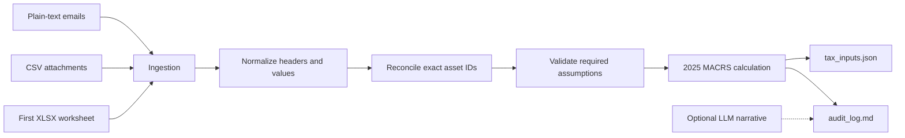

# US Federal Tax Depreciation Reconciliation Demo

[](https://www.python.org/)
[](#quick-start)
[](#supported-rule-scope)
[](#important-disclaimer)

**A dependency-free Python engine for reconciling asset records and producing auditable 2025 MACRS GDS estimates.**

This project reads labeled text emails, CSV files, and the first worksheet of `.xlsx` workbooks, reconciles them by exact asset ID, and writes two deterministic deliverables:

1. A normalized JSON calculation export.
2. A calculation-by-calculation Markdown audit log.

```text
Email + CSV + Excel
        |
        v
  Normalize & reconcile
        |
        v
  Validate assumptions
        |
        v
2025 MACRS GDS calculation
        |
        +--> tax_inputs.json
        `--> audit_log.md
```

---

## Table of contents

- [What this demo does](#what-this-demo-does)
- [How it works](#how-it-works)
- [Quick start](#quick-start)
- [Command-line options](#command-line-options)
- [Input formats](#input-formats)
- [Supported rule scope](#supported-rule-scope)
- [Calculation methodology](#calculation-methodology)
- [Output files](#output-files)
- [Example output](#example-output)
- [Validation and conflict handling](#validation-and-conflict-handling)
- [LLM integration and privacy](#llm-integration-and-privacy)
- [.xlsx support](#xlsx-support)
- [Project structure](#project-structure)
- [Testing](#testing)
- [Known limitations](#known-limitations)
- [Frequently asked questions](#frequently-asked-questions)
- [Disclaimer](#important-disclaimer)

---

## What this demo does

The engine provides a focused, inspectable reconciliation and calculation workflow.

| Capability | Supported behavior |
|---|---|
| Email ingestion | Reads `.txt` email files with labeled asset fields |
| CSV ingestion | Reads records and recognizes common header aliases |
| Excel ingestion | Reads the first worksheet of standard `.xlsx` workbooks |
| Reconciliation | Merges records only when asset IDs match exactly |
| Conflict detection | Rejects conflicting non-empty values instead of guessing |
| Tax year | Limited to tax year 2025 |
| MACRS classes | Explicit 5-year and 7-year GDS property |
| Convention | 200% declining balance with half-year convention |
| Special depreciation | Uses an explicitly supplied percentage |
| JSON export | Writes normalized values and calculation details |
| Audit output | Records formulas, sources, assumptions, and per-asset math |
| Optional narrative | Uses an OpenAI-compatible cloud endpoint or local Ollama |
| Resilience | Produces deterministic exports and audit math even when AI is unavailable |

The included sample demonstrates **101 unique assets** in a single `sample_assets.csv`, reconciled with one email for `DEMO-001`.

---

## How it works



The reconciliation and tax calculations do not depend on an LLM. AI text is used only as an optional, clearly labeled report introduction.

---

## Quick start

### Requirements

- Python 3.10 or newer
- No third-party Python packages
- PowerShell, Command Prompt, or another terminal

### Run the demo

From the project directory:

```powershell
python main.py
```

Expected console output:

```text
Processed 101 asset(s).
JSON export: F:\Tax_engine\output\tax_inputs.json
Audit log: F:\Tax_engine\output\audit_log.md
```

The command creates or updates:

- `output/tax_inputs.json`
- `output/audit_log.md`

No setup, virtual environment, package installation, database, or external service is required for the deterministic workflow.

---

## Command-line options

```powershell
python main.py --help
```

| Option | Default | Description |
|---|---|---|
| `--data-dir PATH` | `data` | Directory containing email and attachment inputs |
| `--output-dir PATH` | `output` | Directory for generated JSON and Markdown files |
| `--tax-year 2025` | `2025` | Supported tax year; this demo accepts 2025 only |

### Custom input and output directories

```powershell
python main.py --data-dir "C:\Demo\Data" --output-dir "C:\Demo\Output"
```

The engine reads `.txt` files from `data_dir/emails` and `.csv`/`.xlsx` files from `data_dir/attachments`. Subdirectories are not searched.

---

## Input formats

Each asset record must contain the fields needed for a safe calculation. Records are matched across files using the exact asset ID.

### 1. Plain-text email

Email files use labeled fields:

```text
Subject: Asset information

Asset ID: DEMO-001
Placed in Service Date: 2025-01-15
Special Depreciation %: 0%
```

The field parser is line-based and supports common aliases.

### 2. CSV attachment

```csv
Asset No,Asset Description,Purchase Price,Business Use %,Depreciation Method,Recovery Period Years,Residual Value,Special Depreciation %,Placed in Service Date
DEMO-001,Office workstation,"1,250.00",100%,macrs_gds_200_db_half_year,5,0,0%,2025-01-15
```

### 3. Excel workbook

Place a standard `.xlsx` workbook in the attachment directory. The engine reads only the first worksheet.

```text
Asset ID | Cost | Business Use % | Method | Recovery Period | Special Depreciation % | Placed in Service Date
A-100    | 5000 | 80%            | macrs_gds_200_db_half_year | 5 | 0% | 2025-03-15
```

### Recognized field aliases

Unknown columns are ignored.

| Canonical field | Example aliases |
|---|---|
| Asset ID | `Asset ID`, `Asset No`, `Asset Number`, `ID`, `Property ID` |
| Description | `Asset Description`, `Description`, `Property`, `Asset Name` |
| Cost | `Cost`, `Purchase Price`, `Cost Basis`, `Acquisition Cost`, `Original Cost` |
| Business use | `Business Use %`, `Business Use`, `Business Percentage` |
| Placed-in-service date | `Placed in Service Date`, `In Service Date`, `Acquisition Date`, `Purchase Date` |
| Method | `Depreciation Method`, `Method` |
| Recovery period | `Recovery Period`, `Recovery Period Years`, `Useful Life`, `Life Years` |
| Residual value | `Residual Value`, `Salvage Value`, `Scrap Value` |
| Special depreciation | `Special Depreciation %`, `Bonus Depreciation %` |
| Region | `Region`, `Jurisdiction`, `Tax Region`, `State`, `Country` |

---

## Supported rule scope

The bundled rules adapter in [`tax_lib/depreciation.py`](tax_lib/depreciation.py) implements a limited 2025 subset of the IRS Publication 946 MACRS GDS percentage schedules (Table A-1):

- Tax year: **2025**
- Property placed in service: **2025**
- Recovery periods: **5-year and 7-year**
- Method: **200% declining balance**
- Convention: **Half-year**
- Residual value: **must be zero**
- Special depreciation: **explicitly supplied; never inferred**

The rule source is [IRS Publication 946 (2025)](https://www.irs.gov/publications/p946).

### 2025 Table A-1 schedules

| Recovery period | Schedule percentages |
|---|---|
| 5-year | 20.00%, 32.00%, 19.20%, 11.52%, 11.52%, 5.76% |
| 7-year | 14.29%, 24.49%, 17.49%, 12.49%, 8.93%, 8.92%, 8.93%, 4.46% |

The two supported schedules each total 100.00%.

---

## Calculation methodology

The annual calculation is performed in three stages:

### 1. Business depreciable basis

```text
business depreciable basis =
    cost x business use percentage
```

### 2. Special depreciation allowance

```text
special allowance =
    business depreciable basis x explicitly supplied special-depreciation percentage
```

### 3. MACRS depreciation

```text
MACRS amount =
    (business depreciable basis - special allowance)
    x applicable Table A-1 percentage
```

The final annual estimate is:

```text
annual depreciation estimate =
    special allowance + MACRS amount
```

For example, an asset costing `$1,250`, used 100% for business, with a 5-year recovery period and 0% special depreciation:

| Step | Calculation | Result |
|---|---|---:|
| Business basis | `$1,250.00 x 100%` | `$1,250.00` |
| Special allowance | `$1,250.00 x 0%` | `$0.00` |
| Table A-1 rate | 5-year, year 1 | `20.00%` |
| MACRS amount | `$1,250.00 x 20%` | `$250.00` |
| Annual estimate | `$0.00 + $250.00` | `$250.00` |

The result matches the included `DEMO-001` sample.

---

## Output files

### `output/tax_inputs.json`

The JSON file contains:

- Schema and ruleset identifiers
- Tax year and rule source
- A normalized asset array
- Cost, business use, recovery period, and special-depreciation values
- Business basis
- Applicable Table A-1 rate
- Special allowance
- MACRS basis
- MACRS and annual depreciation amounts
- Source file provenance

Currency and percentage values are decimal strings in JSON. This avoids binary floating-point representation issues.

### `output/audit_log.md`

The Markdown audit log includes:

- Processing and ruleset summary
- Narrative-provider status
- Formula definitions
- Each asset's source files and assumptions
- Each calculation stage
- A total of displayed annual estimates
- A reminder that the report is educational and not a tax filing

---

## Example output

Example JSON entry:

```json
{
  "asset_id": "DEMO-001",
  "description": "Office workstation",
  "placed_in_service_date": "2025-01-15",
  "method": "macrs_gds_200_db_half_year",
  "tax_year": 2025,
  "recovery_period_years": "5.00",
  "cost": "1250.00",
  "business_use_pct": "100.00",
  "special_depreciation_pct": "0.00",
  "business_depreciable_basis": "1250.00",
  "macrs_table_rate_pct": "20.00",
  "special_depreciation_amount": "0.00",
  "macrs_basis_after_special_depreciation": "1250.00",
  "macrs_depreciation_amount": "250.00",
  "annual_depreciation_estimate": "250.00",
  "source_files": [
    "demo_asset.txt",
    "sample_assets.csv:2"
  ]
}
```

Displayed currency values are rounded to cents using **round-half-up**. Actual tax forms may require different rounding or additional adjustments.

---

## Validation and conflict handling

The engine fails a run safely when it encounters invalid or ambiguous data.

Validation includes:

- Exact asset ID matching
- Required asset ID
- Valid numeric values
- Business use from 0% through 100%
- Special-depreciation percentage from 0% through 100%
- Supported 5-year or 7-year recovery period
- Explicit depreciation method
- Property placed in service in 2025
- Zero residual value
- Conflicting values within one record or across sources

If two non-empty values disagree for the same asset, the run stops and reports the conflict. The engine does not choose a source by file name or load order.

If a source is missing a required value, reconciliation may not complete because the engine cannot safely infer the required tax assumption.

---

## LLM integration and privacy

Reconciliation, validation, tax-table lookup, and calculation remain fully deterministic. The only optional AI use is a short narrative introduction.

Configure a cloud OpenAI-compatible HTTPS endpoint:

```powershell
$env:TAX_CLOUD_BASE_URL = "https://api.example.com/v1"
$env:TAX_CLOUD_API_KEY = "replace-with-an-environment-secret"
$env:TAX_CLOUD_MODEL = "model-name"
```

Configure a local Ollama endpoint:

```powershell
$env:TAX_LOCAL_URL = "http://127.0.0.1:11434"
$env:TAX_LOCAL_MODEL = "llama3"
```

Routing behavior:

1. Cloud endpoint, when configured
2. Local Ollama endpoint
3. Deterministic fallback

Cloud requests use `/chat/completions`. Local requests use Ollama `/api/generate`. Requests use Python's standard library and a three-second timeout.

The narrative prompt contains no asset data. Despite this, credentials should remain environment variables and should never be committed. Real client asset data should not be sent to an unapproved provider.

If both generation routes fail, the engine still writes both outputs and records a deterministic fallback in the audit log.

---

## `.xlsx` support

Supported:

- Standard, unencrypted `.xlsx` workbooks
- First worksheet only
- Shared-string and inline-string cells
- Cached formula values
- Percentage styles
- Common date formats

Workbook limits:

| Limit | Value |
|---|---:|
| Maximum uncompressed size | 20 MB |
| Maximum archive entries | 256 |

Not supported:

- `.xls` files
- Macro-enabled workbooks
- Multiple worksheets
- Encrypted workbooks
- External links
- Formula recalculation
- Unusual workbook structures

Formula cells use only their cached value. The engine does not calculate spreadsheet formulas.

---

## Project structure

```text
Tax_engine/
|-- main.py                 # Command-line entry point
|-- README.md               # Project documentation
|-- agents/
|   |-- ingestion.py        # Email, CSV, XLSX parsing and reconciliation
|   |-- reasoning.py        # Calculation orchestration and validation
|   `-- supervisor.py       # Workflow, atomic exports, and audit generation
|-- data/
|   |-- emails/             # Plain-text email examples
|   `-- attachments/        # CSV/XLSX examples
|-- llm/
|   `-- router.py           # Cloud/local/deterministic text routing
|-- tax_lib/
|   `-- depreciation.py     # Limited 2025 MACRS reference schedules
|-- output/
|   |-- tax_inputs.json     # Generated JSON export
|   `-- audit_log.md        # Generated calculation audit
`-- tests/
    `-- test_engine.py      # Unit and integration coverage
```

---

## Testing

Run the complete test suite:

```powershell
python -m unittest discover -s tests -v
```

The suite covers:

- Header and value normalization
- Source reconciliation
- Conflict detection
- Required-field validation
- `.xlsx` parsing
- 5-year and 7-year MACRS calculations
- Special-depreciation handling
- JSON and Markdown generation
- Cloud-to-local LLM fallback
- Deterministic output during generation outages

Tests verify the demo implementation, but they do **not** constitute an IRS certification or a complete federal tax-law validation suite.

---

## Known limitations

The current ruleset does not determine or support:

- Asset classes derived only from descriptions
- Other recovery periods or conventions
- ADS or straight-line tax elections
- Section 179 deductions
- Bonus-depreciation eligibility
- Mid-quarter convention
- Dispositions or disposals
- Listed-property restrictions
- Business-use qualification
- Passenger or luxury vehicle rules
- State or local tax
- Other tax jurisdictions
- Real estate or land
- Residual values other than zero
- Elections or effective-date qualifications
- Property placed in service outside 2025

The bundled special-depreciation field must come from a qualified review based on acquisition facts and applicable law. This tool does not determine that percentage.

The rules are fixed and are not automatically updated when tax law or IRS publications change.

---

## Frequently asked questions

### Does this project calculate real tax returns?

No. It demonstrates a limited 2025 MACRS GDS calculation and reconciliation workflow for educational and testing purposes.

### Can it infer an asset's MACRS class?

No. Asset descriptions are informational only. Recovery period, method, business use, placed-in-service date, and special-depreciation percentage must be supplied explicitly.

### Does it support special depreciation?

It applies an explicit supplied percentage to the business depreciable basis. It does not determine eligibility, election, effective date, or legal qualification.

### What happens if sources disagree?

The engine rejects conflicting non-empty values. It does not silently prefer email, CSV, or Excel data.

### Does the engine need internet access?

No, not for core processing. Internet access is needed only for an optional configured cloud model. Local Ollama is optional as well.

### Can formulas be used in Excel?

The parser reads cached formula values. It does not calculate formulas itself.

---

